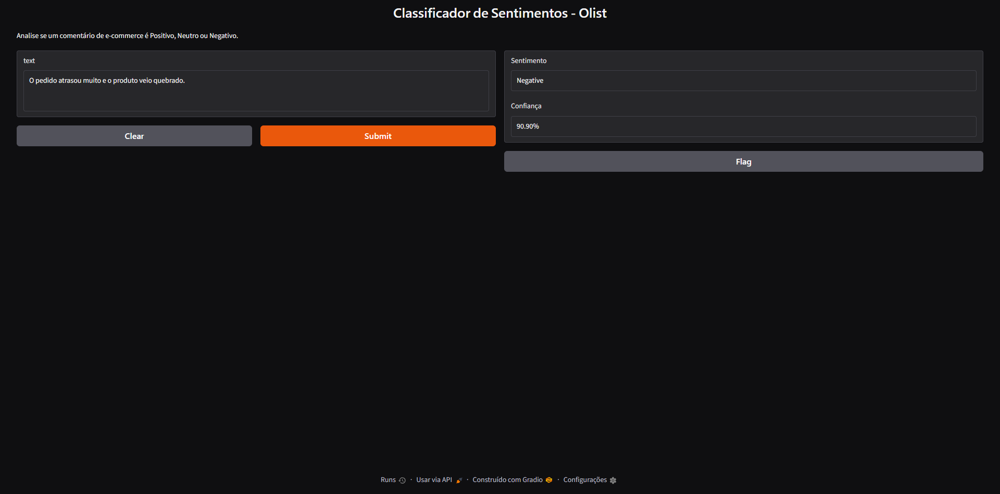

# OLIST SENTIMENT CLASSIFIER

## DESCRIPTION

If you're reading this, you probably just stumbled upon this repository. Either way, welcome!

This project is a NLP model designed to classify Brazilian e-commerce reviews (from the Olist dataset) into three sentiment categories: Positive, Neutral, and Negative. I built this as part of my journey through the **Associate AI Engineer for Developers** Career Track on DataCamp, applying Transformers and fine-tuning in a real-world scenario.

The model is published and available for use on the Hugging Face Model Hub: [aluc0de/bertimbau-olist-sentiment](https://huggingface.co/aluc0de/bertimbau-olist-sentiment)

## FEATURES

- Data cleaning and text preprocessing.
- Derivation of sentiment labels from review scores.
- Fine-tuning of BERTimbau (Portuguese BERT) for 3-class classification.
- Evaluation using Accuracy, Precision, Recall, F1-Score, and Confusion Matrix.
- Model published on Hugging Face.
- Interactive web interface built with Gradio.
- Modular codebase for training and inference.

## DESIGN DECISIONS AND CHALLENGES

**The Class Imbalance Problem:** The Olist dataset is heavily skewed towards positive reviews. The model achieved 84% accuracy but struggled with the "Neutral" class (F1-score 0.10). This is a classic NLP challenge. I know that just looking at accuracy is a trap here. Future work would definitely include class weighting or oversampling the minority class to help it recognize those neutral comments better.

**The Pipeline Refactor (Separation of Concerns):** At first, my `train.py` script was a mess. It was responsible for loading the raw Olist CSV, cleaning the text, creating the labels, splitting the data, and then finally training the model—all in one go. I realized this was inefficient and fragile. So, I redid the architecture: the data preparation is now handled exclusively by the Jupyter Notebook, which outputs clean `train.csv`, `val.csv`, and `test.csv` files. Now, `train.py` simply loads these pre-processed files. It makes the training script so much cleaner and easier to debug.

**The GPU Dilemma:** My local machine has an AMD GPU, which means setting up PyTorch with ROCm on Windows would have been a huge headache. Instead of spending days configuring the environment, I just used Google Colab's free T4 GPU to fine-tune the model in about 30 minutes.

**Label Derivation:** The sentiment labels were not manually annotated by me. They were derived from the `review_score` column (1-2 = Negative, 3 = Neutral, 4-5 = Positive). This means ironic or nuanced comments might be misclassified. For example, a factual phrase like "The product arrived" might be classified as Positive because it's often associated with high ratings in the dataset, even if it doesn't express a strong opinion. I made sure to document this limitation clearly in the Model Card.

## PROJECT FILES

- `notebooks/01_data_preparation.ipynb`: Data loading, cleaning, label creation, train/val/test split, and saving the final CSVs.
- `src/preprocessing.py`: Functions for text cleaning and label creation (used by the notebook).
- `src/train.py`: Fine-tuning script for the BERTimbau model (expects the pre-processed CSVs).
- `src/predict.py`: Inference script that loads the model from Hugging Face and classifies new text.
- `app.py`: Gradio web interface for interactive testing.
- `README.md`: This file.
- `requirements.txt`: Project dependencies.

## LIVE DEMO

You can test the model interactively using the web interface built with Gradio.

To run it locally:
1. Install the dependencies: `pip install -r requirements.txt`
2. Run the app: `python app.py`
3. Open the link provided in the terminal (usually `http://127.0.0.1:7860`).

*The web interface classifying a sample review.*

## REQUIREMENTS AND USAGE

To install the dependencies:
`pip install -r requirements.txt`

**Step 1: Prepare the data**
Download the `olist_order_reviews_dataset.csv` from Kaggle and place it in the `data/` folder. Run the `01_data_preparation.ipynb` notebook to generate the `train.csv`, `val.csv`, and `test.csv` files.

**Step 2: Train the model**
(Requires a GPU for reasonable speed, or use Google Colab)
`cd src`
`python train.py`

**Step 3: Make a prediction**
This step does not require training locally. It downloads the trained model directly from Hugging Face.
`cd src`
`python predict.py`

## FINAL THOUGHTS

This project was a deep dive into the world of Transformers and fine-tuning. I learned that data quality, class balance, and a clean code architecture are just as important as the model architecture itself.

I'm proud of the result and excited to continue exploring NLP.

Thank you for taking the time to look at my work!

This was me, Goodbye!
